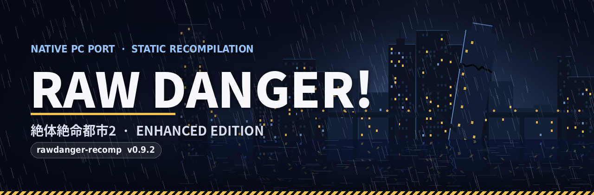

<p align="center">
  
</p>

<p align="center">
  <a href="https://github.com/rams95blue/rawdanger-recomp/releases"></a>
  
  
  
  
</p>

<p align="center">
  <b>Raw Danger!</b> (PS2, 2006) and <b>Zettai Zetsumei Toshi 2</b>, running natively on Windows.<br>
  Built from <b>your own discs</b>: the game's code is translated to C++ and compiled for your PC. No emulator, no game data included.
</p>

<p align="center">
  <a href="#quick-start">Quick start</a> ·
  <a href="#highlights">Highlights</a> ·
  <a href="#play-windows">Full guide</a> ·
  <a href="docs/ROADMAP.md">Roadmap</a> ·
  <a href="docs/CAMERA.md">How it works</a>
</p>

---

## Highlights

| | |
|---|---|
| **Enhanced Edition** | Built from your four discs: the US game with the Japanese voices, faces, signs, logo and opening film, each switchable while you play. Its title reads ENHANCED EDITION with the build number. |
| **Any resolution, any screen** | Internal resolution 1x to 8x, widescreen, full screen, FSR 1, SMAA, sharpening, field of view 80 to 150 %. |
| **The PS2 look, kept or cleaned** | The game's own glow, tint and haze in one cheap GPU pass; ambient occlusion; a hero who looks wet when soaked; rain on the lens that follows the weather; cutscene bars from 100 % to none. |
| **A modern camera** | Mouse look in the follow and first-person views, an orbit camera that circles the hero, free tilt, a hero who turns the head where you look, and an option to keep your camera where the game has a fixed one. |
| **Achievements, offline** | RetroAchievements' set of 83, checked on your PC: no account, no connection, badges and progress in the game. |
| **Saves as folders** | Every save is a plain folder next to the launcher: copy it, back it up, share it. |
| **PC controls** | Rebindable keys with key caps, the PC keys shown in the game's own texts, F-key shortcuts, fast forward. |
| **Every patch is a switch** | Widescreen, intro logos, filters, regional textures: in the launcher and live in the game (F3). |

## Quick start

1. **Download** the latest release and unzip it anywhere.
2. **Run `RawDangerPC.exe`**, point it at your disc images and press **Build**: LEGACY converts one disc as it is; MODERN builds the Enhanced Edition once it has found all four (US, Japanese and the two Japanese demos). The first build fetches the nine free build tools from their official pages (about 330 MB) and takes a few minutes.
3. **Play.** F1 opens the PC menu in the game, F3 the game's switches, F10 shows your keys.

You need: Windows 10 or 11 (64-bit), a GPU with Vulkan or DirectX 12, and your own copies of the discs (Raw Danger! USA SLUS-21501; for the Enhanced Edition also Zettai Zetsumei Toshi 2, SLPS-25606, and its two demos).

## Screenshots

<!-- Add your own captures here: docs/images/shot-1.png ... -->
*Screenshots from your own build go here.*

---

# Full guide

A native Windows port of **Raw Danger!** (USA, SLUS-21501) and **Zettai Zetsumei Toshi 2** (Japan, SLPS-25606), plus
both Japanese demos, made from your own discs with our fork of
[ps2-native-recomp](https://github.com/exoteric33/ps2-native-recomp) (`engine\ps2-native-recomp`, see
`engine\FORK.md`). No game data is included. You need your own discs.

## Play (Windows)

Run **RawDangerPC.exe**. It has two tabs. **MODERN** (first, recommended) builds the **Enhanced Edition**: everything this
project adds, from your four discs. **LEGACY** converts one disc as it is, with a few options. Choose the **build speed**
(Light keeps the PC quick for other work, Balanced, Full is the fastest), build, then press Play or make a desktop shortcut.
The first build downloads the nine build tools from their official pages once (about 330 MB); already have them? **Build
tools...** lists them with their links and where they are found (docs/BUILD_TOOLS.md).

- **Games**: US, JP, JP demo Type-A, JP demo Type-B, and the **Enhanced Edition** (built from the US disc, with the
  Japanese voices from the JP disc; offered once all four discs are found). It starts as the US release (English voices, US
  pictures, logo and film); its title screen reads ENHANCED EDITION with the build number by the logo, in the US logo's yellow
  or the Japanese logo's white. To redraw those words: `python tools/rd_title_art_source.py psd <TITLE.DAT> us|jp out.psd`
  makes a layered PSD at 8 times the size; after editing it, `python tools/rd_title_art_source.py png edited.psd
  tools/title_art_us.png` (or `title_art_jp.png`) cuts the words out of Photoshop's own picture (layer effects included),
  and the next build uses them. The PSDs of the current words are in `launcher\art\rawdanger-title-art`.
- **Recomp options**: every patch as an option, in the launcher and in the game (F1 -> Recomp options, or F3). They
  switch while you play: widescreen, intro logos, the PS2 post-processing filter, and in the Enhanced Edition **Japanese / English
  voices**, **Japanese faces and hair** and **Japanese signs** (the 151 textures the US release redrew, from the JP disc).
  The Enhanced Edition has no build options: everything is in it and switched in the game.
- **Achievements** (US, Japanese and Enhanced): offline, unlock pop-up with the badge in the game, list on F1 ->
  Achievements (F4) and in the launcher, with your progress (unlocked, points, %). RetroAchievements' set (83) is kept in
  `achievements\ra\5616.json` and checked on this PC: no account, no connection. It is made for the European and Japanese
  programs; the US build and the Enhanced Edition use `5616.us.json`, the same set moved to the US program's addresses
  (`rd.py ra-port`). `rd.py ra-logic` writes what each one checks, in words. A newer set can be taken from PCSX2's RAIntegration
  copy (launcher -> Achievements). Badges from the export in `launcher\art\Raw Danger! - Achievement Icons`: in colour once
  unlocked, grey until then. Each achievement can be switched off (launcher list, or Enter on the in-game page).
- **In the game**: F1 opens the menu (Resume, Quick save/load, Settings, Achievements, Language, Quit to desktop).
  *Settings* has tabs (Tab / Q / E, L1 / R1 or the mouse): **Display** (internal resolution 1x-6x, 8x or auto, at once;
  window size, full screen, widescreen, whole-number scaling, pause in the background, menu look), **Picture** (upscale
  filter: raw pixels, soft, sharp or FSR 1; anti-aliasing: smooth edges or SMAA low to ultra; **sharpen the picture** (off,
  low, medium, high; off by default: the picture is crisp by itself); text and menus; **field of view** (80 % to 150 % of the game's); the **PS2 post-processing filter** (the
  game's own glow, tint and haze; on by default: now one GPU-friendly pass, as cheap as off, and without the blurry picture
  it used to bring); **cutscene black bars** by opacity, 100 % (as the game draws them) down to 0 (removed: the picture fills the
  screen); rain on the lens (on by default, as hard as it rains, in gusts, heavier when the camera looks up),
  which follows the map's weather and stays under the HUD, the texts and the bars), **Sound** (master volume, reverb),
  **Controls** (change keys with key caps, **mouse look** with speed and invert (since v0.7.9 the mouse turns the camera
  itself: as far as it moved, no top speed; build the game again once to get it), the PC keys shown in the game's own texts
  and in its menus' button pictures (v0.9.3) in place of the PlayStation symbols, **Camera up/down** (v0.9.0: ORBIT circles the hero at the same distance, PS2 tilts and
  zooms as on the console) and **Fixed cameras** (OFF keeps your camera in the places that have a fixed one; ON by default) and **Head follows camera** (v0.9.4: the hero looks where the camera looks; on by default)), **Game** (the game's other switches, and the developers' map select). Every one of
  these settings is also a **row of the game's own Options screen** (from the title and from the in-game menu's Options
  tab), with the game's live options of recomp.ini: they sit in the game's list like its own lines (the same cursor,
  Left / Right, help line; "< value >" for settings with more steps), and the list scrolls. The game **goes on behind the
  F1 menu** (Settings -> Display -> *Game runs behind this menu*; off: it waits). See docs/GRAPHICS.md.
- **Keys**: F1 menu, F2 picture look, F3 game options, F4 achievements, F5 / F8 quick save / load, **F6 held: fast
  forward** (skips through cutscenes, talks and walks at the game's top speed), **F7: the developers' map select** left on
  the disc (up / down a line, left / right its value, Cross loads the map; docs/DEBUG.md), F9 report, **F10 your keys on screen**, F11 full screen. (The developers' other menu, DEBSEL, only led to the map select, so v0.8.9 dropped its Shift+F7; docs/DEBUG.md lists what else the disc still names.) The camera tilts much further up and down
  than on the PS2 (free tilt since v0.8.6, a switch in F3). The mouse wheel sets
  walk or run for the walk keys (up runs, down walks) when no button is put on the wheel. The memory-card
  check at start is not shown at all (the card is still read).
- **Language** (F1 -> Language): restarts in the other language with your saves carried over (US / Enhanced <-> the JP
  build; build both).
- **Saves without the memory card**: your saves are plain folders in `saves` beside RawDangerPC.exe (one per save; copy,
  back up or share them as folders). The game's card image is made from them at each start and written back when the game
  ends; your old card's saves are brought in the first time (docs/SAVES.md). The engine is ps2-native-recomp of 2026-11-18 with our patches. Each run adds a performance line to `logs\<game>_performance.log`.
- **Engine**: the fork in `engine\ps2-native-recomp` is kept for Raw Danger on its own (`engine\FORK.md`): the launcher no
  longer looks for upstream changes at start (`EngineCheck2=1` in launcher.ini turns the check back on; `rd.py engine-check`
  writes the same report by hand).
- **Builds**: the launcher shows an estimated time before and during a build (your last build of the same game, or a
  typical time), and cleans up afterwards: the translated code and compiler objects go, and the copy of an .iso disc too
  (the game reads your .iso where it is, so a game folder holds no disc image unless it came from a .cue/.bin).
- **Music**: put a music file of your own (.flac/.mp3/.wav/.wma, any name) in the art folder (`launcher\art`, with the
  cast pictures) and the launcher plays it at MusicVolume= (launcher.ini, default 0.25); a file named `music.*` wins; the
  Music button turns it off.
- Undub discs (Japanese voices modded into the US disc) are not compatible: the launcher marks them and says why.

Docs: `docs\ROADMAP.md` (what is done and what is next), `docs\DEMOS.md` (the demos compared with retail),
`docs\VOICE_SWAP.md`, `docs\NATIVE_RECOMP.md`.

## Tools (rd.py)

`rd.py demos` compares the demo discs with retail (`work\reports\demos.md`). The rest of `rd.py` is the older
ps2recomp pipeline, kept for its research; the sections below describe it.

## The older ps2recomp pipeline

### Status (ps2recomp pipeline, superseded)

| Area | State |
|---|---|
| Disc extraction (US + JP), ELF CRC/serial | ✅ working (`rd.py extract`) |
| US vs JP asset measurement (audio rates, textures, FMV bitrate, compression) | ✅ working (`rd.py compare`) |
| ELF analysis: IRX list, SDK versions, hard-coded disc TOC detection | ✅ working (`rd.py analyze`) |
| ps2recomp config generation, merged with Ghidra/analyzer output | ✅ working, validated against the real `ps2_recomp` parser |
| Code patches baked at recompile time (`no_post_filter`) | ✅ wired (verified `Applied patch at …` in ps2_recomp) |
| Runtime data patches (widescreen), verified against original bytes | ✅ wired in game module |
| Host display aspect 4:3 / 16:9 | ✅ via runtime patch `0001-rawdanger-runtime-hooks.patch` |
| Original-ISO mount for raw-sector (LBA) reads | ✅ wired |
| JP voice switch: hybrid `STR.FAT`/`STR.DAT` built from your discs, served at runtime | ✅ `rd voicepack` (index format decoded from your discs; tested on your real indexes) |
| ps2recomp + our patch + game module build, link and run | ✅ `ps2EntryRunner` built; module matched the ELF, mounted the ISO, applied patches, loaded voice routes at boot (synthetic ELF) |
| Raw Danger itself booting in the recomp | ⏳ not attempted yet — first real milestone |
| MWo3 overlay modules recompiled | ⏳ needs format RE (see ROADMAP) |
| GPU renderer / internal resolution upscaling | ⏳ needs a GPU `GSRasterBackend` (runtime GS is CPU-only today) |

Everything marked ✅ was tested end-to-end on synthetic discs/ELFs built to
match the real layout, with a real build of ps2recomp at the pinned commit.
None of it has touched your real discs yet, because I couldn't read 1.6 GB+ ISOs
from this session — that's step 1 below.

License: ps2recomp is GPL-3.0 and this project patches and links it, so GPL-3.0
is the natural choice if you publish it.

## Quick start (Windows)

Requirements: Git, CMake ≥ 3.21, Visual Studio 2022 (Desktop C++), Python ≥ 3.11.
Recommended: Ghidra 12.2 (JDK 25) + [ghidra-emotionengine-reloaded](https://github.com/chaoticgd/ghidra-emotionengine-reloaded) built for the same version.

```bat
cd "RAW DANGER DECOMP\rawdanger-recomp"
rd extract      :: both ISOs -> work\us, work\jp   (~4 GB of disk)
rd compare      :: -> work\reports\report.md   <- answers "which version is better"
rd analyze      :: -> work\reports\elf_us.md, elf_jp.md + patch-site verification
rd setup        :: clone ps2recomp @ pinned commit, apply our patches, build tools
rd ghidra       :: headless Ghidra (found next to this folder) -> work\ghidra\*.toml/.csv
rd config       :: -> recomp\out\config.toml
rd recomp       :: generate C++ into ps2recomp\ps2xRuntime\src\runner
rd build        :: -> ps2EntryRunner.exe
rd run
```

`rd all` runs setup → build in one go.

`rd build` turns OFF whole-program optimization (`/GL` + `/LTCG`): over ~1M
recompiled instructions it exhausts MSVC's heap (C1002 / LNK1257) even with
64 GB. `--ltcg` turns it back on, `--unity-batch 8` lowers per-file memory, and
`--jobs N` limits parallel compiles. `rd voicepack` builds the JP voice pack
(see [docs/VOICE_SWAP.md](docs/VOICE_SWAP.md)).

**Send me back** `work/reports/report.md`, `elf_us.md`, `elf_jp.md` and the
`rd analyze` console output. Those decide the next steps: which version's assets
to use, whether the game needs the ISO mounted, and where the voices live.

## Settings — `rawdanger.ini` (next to the ELF)

```ini
[disc]     image = <path to Raw Danger (USA).iso>
[display]  aspect = 16:9            ; 4:3 | 16:9 | 16:10 | native
[patches]  widescreen = true        ; runtime data patches from patchdb.json
[audio]    voice_language = en      ; en | jp
[debug]    log = true
```

Code patches (e.g. `no_post_filter`) are compiled in; choose them with
`rd config --code-patches widescreen,no_post_filter`.

## Layout

```
rd.py / rd.bat             pipeline
tools/rd_iso.py            ISO9660 extractor (stdlib, streams multi-GB images, LBA manifest)
tools/rd_scan.py           asset scanner + US/JP comparison report
tools/rd_elf.py            ELF analysis + patch-site verification
tools/rd_mkconfig.py       config.toml + game-module headers generator (cleans the Ghidra map)
tools/ghidra/RdExportPS2.java  headless wrapper for ps2recomp's Ghidra export script
tools/rd_strpack.py        hybrid JP voice archive builder (STR.FAT/STR.DAT)
tools/rd_voicepack.py      generic per-file voice routes
patches/patchdb.json       patch database (sources cited per patch)
patches/ps2recomp/*.patch  small runtime hooks applied on top of ps2recomp
recomp/game/               game module compiled into ps2EntryRunner
recomp/rawdanger.ini       default settings
docs/                      WORKFLOW, VERSION_DIFFERENCES, VOICE_SWAP, ROADMAP
```

---

<p align="center"><sub>Raw Danger! and Zettai Zetsumei Toshi are trademarks of their respective owners. This is a fan project: it ships no game code or data and builds only from discs you own. The banner is original art (<code>tools/rd_readme_art.py</code>).</sub></p>
